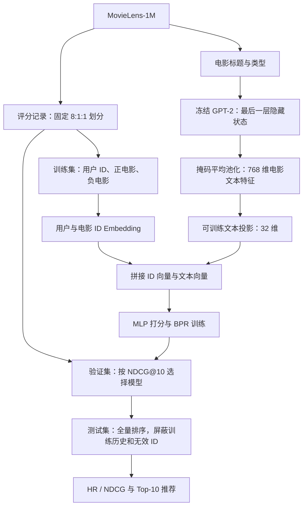

# 基于 GPT-2 特征增强的电影推荐系统

本项目是“小组完成一个大语言模型增强的推荐系统（核心算法）”课程实践，使用 Python、PyTorch 和 MovieLens-1M，完成电影文本特征提取、成对排序训练、全量 Top-K 评测及推荐输出。

核心模型将用户 ID、电影 ID 的可训练向量与 **冻结 GPT-2 提取的电影标题和类型特征**融合，再通过 MLP 打分。GPT-2 仅用于离线特征提取，不参与推荐训练的参数更新，也不生成推荐理由。热门推荐和纯 ID NCF 用于检验推荐效果及文本特征的贡献；增强效果以实际对照实验为准。

- [实验报告](report.md)：数据划分、算法实现、指标定义、实验结果及局限。
- [server1 实验产物](results/server1/)：统一配置下的基线对比与运行记录。
- [小组成员与贡献记录](docs/team.md)：提交前填写真实成员信息和复核记录。

## 已完成的统一对照结果

全量 MovieLens-1M，固定数据划分，训练预算 3 轮。NCF 和 Hybrid 使用相同的 3 个随机种子，表中为均值 ± 样本标准差；Popularity 只评测一次。

| 方法 | 测试 HR@10 | 测试 NDCG@10 |
| --- | ---: | ---: |
| Popularity | 0.490937 | 0.109185 |
| 纯 ID NCF | 0.489034 ± 0.004894 | 0.106157 ± 0.001143 |
| NCF + GPT-2 | **0.523218 ± 0.003204** | **0.123550 ± 0.000784** |

在本次实验中，Hybrid 相对 NCF 的平均 HR@10 提高 3.42 个百分点，平均 NDCG@10 相对提高 16.38%。这个结果支持当前文本分支在本设置下有效；两模型参数量不同，尚不能独立归因于 GPT-2 的语义质量，也不代表充分收敛或跨数据集结论。详见[完整指标](results/server1/summary.csv)和[实验分析](report.md)。


## 方法与对照

| 方法 | 使用的信息 | 作用 |
| --- | --- | --- |
| Popularity | 训练集中的电影交互次数 | 检验是否超过简单热门推荐 |
| NCF | 用户 ID、电影 ID | 不使用文本的神经协同过滤对照 |
| NCF + GPT-2（Hybrid） | 用户 ID、电影 ID、电影标题及类型的 GPT-2 特征 | 检验加入文本分支后的表现 |

NCF 与 Hybrid 使用 BPR 损失学习同一用户的正、负电影排序。默认 ID 向量维度为 32；Hybrid 将 768 维文本向量投影到 32 维，与两个 ID 向量拼接后输入 MLP。GPT-2 特征固定，文本投影层与推荐网络参与训练。



## 项目文件

| 文件或目录 | 内容 |
| --- | --- |
| `ml-1m/` | MovieLens-1M 用户、电影及评分数据 |
| `gpt2_model/` | 随项目提供的本地 GPT-2 权重与分词器 |
| `dataset.py` | 数据读取与固定 8:1:1 划分 |
| `dataloader.py` | 训练负采样及评测用户组织 |
| `gpt2.py` | 冻结 GPT-2 文本特征提取 |
| `recommender.py` | GPT-2 + NCF 混合推荐模型 |
| `baselines.py` | 热门推荐及纯 ID NCF 对照模型 |
| `trainer.py` | 课程训练流程与固定 HR / NDCG 评测实现 |
| `main.py` | 原课程单模型训练、评测及推荐入口 |
| `run_benchmarks.py` | 热门推荐、纯 NCF、Hybrid 的统一实验入口 |
| `movie_features.pt` | 按原始电影 ID 索引的文本特征，形状 `(3953, 768)` |
| `checkpoint.pth` | 原课程入口保存的模型权重 |
| `results/server1/` | server1 对照实验输出 |
| `scripts/plot_benchmarks.py` | 从完整真实结果生成对比图与训练曲线 |
| `requirements-plot.txt` | 绘图所需的独立依赖 |
| `requirements-benchmark.txt` | server1 对照实验的训练依赖版本 |
| `figures/` | SVG 图、PNG 预览及图表来源记录 |
| `report.md` | 实验报告 |
| `docs/team.md` | 小组成员、贡献与交叉复核记录 |

## 环境与文件下载

课程依赖见 `requirements.txt`，默认建议 Python 3.10。复现实验时，以结果目录记录的实际软件版本、设备和运行配置为准。原入口会自动选择 CUDA 或 CPU；下面的正式对比命令明确使用 CUDA。

本次 server1 基线实验使用 Python 3.10.19、PyTorch 2.5.1+cu121、NumPy 2.2.6、pandas 2.2.2、tqdm 4.67.1、Transformers 4.57.3，与原课程依赖版本不同，具体记录见 [manifest.json](results/server1/manifest.json)。该实验复用仓库已有的 `movie_features.pt`，没有重新运行 GPT-2 特征提取；不能据此声称新版 Transformers 已通过从零提取流程的复现验证。

仓库的数据、模型权重和特征使用 **Git LFS** 管理。请先在系统中安装 Git LFS，再执行：

```bash
git lfs install
git clone https://github.com/xiuyunMarx/SJTU-course-project-hybrid-rec.git
cd SJTU-course-project-hybrid-rec
git lfs pull
git lfs ls-files
```

已有仓库直接在项目目录运行 `git lfs pull` 即可。若 `.pt`、`.pth`、`.safetensors` 或数据文件中只有 `version https://git-lfs.github.com/spec/v1` 等几行文字，说明仍是 LFS 指针，需要完成大文件下载后再运行。直接下载源码 ZIP 不应作为已取得全部大文件的依据。

在独立环境中安装课程依赖：

```bash
python -m venv .venv
source .venv/bin/activate
python -m pip install -r requirements.txt
```

Windows 可使用 `.venv\Scripts\activate` 激活环境。CUDA 训练需要可用的 NVIDIA GPU、驱动和兼容的 PyTorch 环境；可先检查：

```bash
python -c "import torch; print(torch.__version__); print('CUDA:', torch.cuda.is_available())"
```

要复现下文的 server1 对照结果，可在新的 Python 3.10 环境中执行 `python -m pip install -r requirements-benchmark.txt`。此配置固定 CUDA 12.1 的 PyTorch 版本，用于已保存文本特征的推荐训练；从零提取特征仍参照课程依赖和上述 GPT-2 权重。

## 运行项目

所有命令均在仓库根目录执行。

### 1. 生成或使用电影文本特征

已通过 LFS 下载 `movie_features.pt` 时，可直接进入训练步骤。要从本地 GPT-2 权重重新提取特征，执行：

```bash
python gpt2.py --model_path gpt2_model --output movie_features.pt
```

也可使用课程默认命令 `python gpt2.py`，它优先读取本地 `gpt2_model/`。输入文本格式为 `Title: <标题>. Genres: <类型>.`，最长 32 个 token。输出包含 3,883 部有效电影；由于原始电影 ID 存在空缺，特征表为 `(3953, 768)`，空缺 ID 对应零向量。

### 2. 运行课程原入口

先用 500 位训练用户检查流程，再进行全量训练：

```bash
python main.py --quick --epochs 2
python main.py --epochs 3
```

程序输出每轮损失、验证指标、最佳模型的测试指标，以及一个用户的 Top-10 推荐。`main.py` 默认将最佳模型写入 `checkpoint.pth`，重复运行会覆盖该文件；需要保留已有模型时，应先另存。

快速模式用于检查流程，其用户集合与全量模式不同，指标不能直接比较。

### 3. 在 server1 运行统一对照

本次 server1 实验使用以下命令，生成的结果已收录在仓库中：

```bash
python run_benchmarks.py \
  --models popularity ncf hybrid \
  --seeds 42 2026 3407 \
  --epochs 3 \
  --device cuda \
  --output_dir results/server1
```

结果目录必须不存在或为空；再次运行请同时指定新的 `--output_dir` 和 `--checkpoint_dir`。默认的各模型最佳权重位于 `artifacts/benchmarks/`，不会覆盖原来的 `checkpoint.pth`。该权重目录不提交到 Git，完整训练日志、指标和输入指纹随仓库提供。

从已有仓库复现时，使用新的结果与权重目录：

```bash
python run_benchmarks.py --models popularity ncf hybrid --seeds 42 2026 3407 \
  --epochs 3 --device cuda --output_dir results/reproduction \
  --checkpoint_dir artifacts/reproduction
```

三个训练种子用于观察初始化、负采样及训练随机性的影响，数据划分仍固定使用种子 42。比较 NCF 与 Hybrid 时保持相同的数据、训练轮数、优化设置和评测口径；按各自的验证集 NDCG@10 选择最佳轮次，再评测测试集。热门推荐无需训练，其电影热度仅统计训练集。

正式结论及结果解释见 [实验报告](report.md)，原始配置、日志和指标见 [结果目录](results/server1/)。不能仅凭 Hybrid 超过热门推荐，就将提升归因于 GPT-2；应结合纯 NCF 对照判断，并说明模型参数量等差异。

实验入口拒绝覆盖非空结果目录及同名训练权重。需要重复实验时，请同时指定新的 `--output_dir` 和 `--checkpoint_dir`，保留已有记录。

### 4. 查看结果并生成图表

| 产物 | 内容 |
| --- | --- |
| [manifest.json](results/server1/manifest.json) | 命令参数、环境、数据划分及代码和输入文件指纹 |
| [summary.csv](results/server1/summary.csv) | 各模型验证、测试指标的均值、样本标准差和运行数 |
| [summary.json](results/server1/summary.json) | 每次运行结果、逐轮记录和配对负采样、样本顺序检查 |
| [run.log](results/server1/run.log) | 整组实验原始日志 |
| [popularity.log](results/server1/popularity.log) | 热门推荐单次评测日志 |
| NCF：[42](results/server1/ncf_seed42.log) / [2026](results/server1/ncf_seed2026.log) / [3407](results/server1/ncf_seed3407.log) | 纯 ID NCF 各种子训练日志 |
| Hybrid：[42](results/server1/hybrid_seed42.log) / [2026](results/server1/hybrid_seed2026.log) / [3407](results/server1/hybrid_seed3407.log) | GPT-2 + NCF 各种子训练日志 |

每份模型日志均有同名 `.json` 记录。热门推荐只运行一次，不估计跨种子方差；NCF 和 Hybrid 各运行三个种子，汇总使用样本标准差（`ddof=1`）。

完成全部七次运行后，在具备绘图依赖的环境执行：

```bash
python -m pip install -r requirements-plot.txt
python scripts/plot_benchmarks.py --results results/server1 --output_dir figures
```

绘图脚本要求七次运行均已完成、三组配对检查全部通过，并核对汇总统计与原始运行值。它输出 [训练曲线](figures/training_curves.svg)、[测试集基线对比](figures/baseline_comparison.svg)及同名 PNG 预览，数据来源哈希记录在 [plot_manifest.json](figures/plot_manifest.json)。图中的色带或误差条为三个种子的均值 ± 样本标准差，不是置信区间；热门推荐标记为单次运行，不绘制方差估计。

## 固定数据与评测口径

- 将全部 1,000,209 条评分记录视为交互正样本，不按评分阈值筛选；按记录随机划分，未采用时间划分。
- 使用课程 `dataset.py` 的固定划分：训练集 800,167 条，验证集与测试集各 100,021 条；验证、测试默认只保留训练集中出现过的用户。
- 每条训练正样本采一个用户训练历史以外的电影，候选来自训练集实际电影；负样本在加载器初始化时生成，跨轮保持固定，不用验证或测试交互排除负例。
- 全量电影排序时屏蔽无效电影 ID 和用户训练历史。测试阶段沿用课程规则，不额外屏蔽验证集交互。
- HR@K 表示至少命中一部真实电影的用户比例；NDCG@K 衡量命中数量及位置，二者均不等同于推荐正确率。
- 验证集用于选择最佳模型，测试集用于最终评测。**保留课程提供的 `trainer.py` 评测逻辑，不修改指标定义来改善结果。**

## 课程实现与提交材料

原课程提供了四处 TODO，本项目已实现；代码中的 TODO 注释保留作为教学出处：

1. `gpt2.py`：最后一层隐藏状态的掩码平均池化。
2. `dataloader.py`：排除用户训练历史的随机负采样。
3. `recommender.py`：用户、电影 ID 与电影文本向量的拼接和打分。
4. `recommender.py`：基于正、负分数差的 BPR 损失。

提交材料包括核心代码、本说明、[实验报告](report.md)、可追溯的[实验记录](results/server1/)以及[小组贡献记录](docs/team.md)。成员姓名和分工须由实际参与者填写并确认。当前实验的结论限于本数据集、固定划分、模型结构及训练预算，不据此推断冷启动、时间外推或其他数据集的效果。
