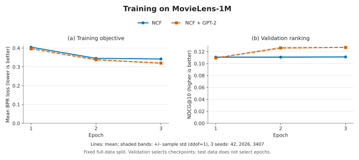
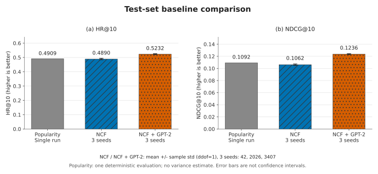

# 基于 GPT-2 特征增强的电影推荐系统实验报告

本报告包含两批独立实验：第 2 节及第 5 节保留原始课程单模型实验的设置与结果；第 6 节记录在 server1 上重新训练的统一基线对比。两批实验的软件环境、评测批大小及随机数管理方式不同，旧模型的单次指标不参与新实验的均值、标准差或增益计算。

## 1. 实验目标

本项目使用 MovieLens-1M 数据集，实现结合协同过滤与电影文本特征的 Top-K 推荐系统。模型通过用户、电影的 ID Embedding 学习交互关系，同时使用 GPT-2 提取电影标题和类型的文本特征，经多层感知机（MLP）输出推荐分数。

项目完成了掩码平均池化、负样本采样、特征融合与打分、BPR 损失四处代码，以及快速训练、全量训练、验证集与测试集评测和 Top-10 推荐。本次进一步补齐 Popularity、纯 ID NCF 与 NCF＋GPT-2 的统一对比，并保存三种子的训练日志、配置、指标和图表。课程提供的评测逻辑保持不变。原始课程实验的终端日志未入库，第 5 节沿用原报告记录；第 6 节新增实验的完整日志已归档。

## 2. 原始课程实验的数据与设置

### 2.1 数据集及划分

MovieLens-1M 包含 6,040 位用户、3,883 部电影和 1,000,209 条评分记录。数据文件分别为 `users.dat`、`movies.dat` 和 `ratings.dat`。

本项目将所有评分记录视为交互正样本，不按评分高低筛选喜欢与不喜欢。数据以固定随机种子 42 打乱后，按 8:1:1 划分；验证集和测试集默认仅保留训练集中出现过的用户。划分采用记录级随机划分，而非按交互时间划分。

| 运行模式 | 训练集交互数 | 验证集交互数 | 测试集交互数 |
| --- | ---: | ---: | ---: |
| 快速模式 | 143,685 | 17,864 | 18,109 |
| 全量模式 | 800,167 | 100,021 | 100,021 |

快速模式选择打乱后训练数据中首先出现的 500 位不同用户，并保留这些用户在三个集合中的交互。全量模式的三个集合合计为 1,000,209 条记录。

### 2.2 原始实验环境与参数

原报告记录运行环境为 `GPTRec`，使用 CUDA。以下版本与参数保留原报告的环境记录，不代表第 6 节 server1 的实际环境。原始终端日志未归档，因此这里不将新增日志用作原实验的运行证据。

| 项目 | 设置 |
| --- | --- |
| Python | 3.12.13 |
| PyTorch | 2.2.1 |
| Transformers | 4.40.2 |
| NumPy / pandas / tqdm | 1.26.4 / 2.2.2 / 4.66.5 |
| GPT-2 权重来源 | 本地 `gpt2_model/` |
| GPT-2 隐藏维度 | 768 |
| 文本特征提取批大小 | 32 |
| 文本最大长度 | 32 个 token，超长文本截断 |
| 用户、电影 ID Embedding 维度 | 各 32 |
| 文本投影维度 | 32 |
| MLP 结构 | Linear(96, 64) → ReLU → Linear(64, 1) |
| 优化器 / 学习率 | Adam / 0.001 |
| 训练批大小 / 评测批大小 | 2,048 / 64 |
| 训练随机种子 | Python、NumPy、PyTorch 均设为 42 |
| 快速训练 / 全量训练轮数 | 2 / 3 |
| 最佳模型选择依据 | 验证集 NDCG@10 |

## 3. 模型原理与代码实现

### 3.1 GPT-2 文本特征与掩码平均池化（TODO1）

每部电影的标题和类型构造成以下文本，类型字段中的 `|` 替换为逗号：

```text
Title: <电影标题>. Genres: <电影类型>.
```

GPT-2 是采用因果注意力的 Decoder 模型。本项目仅使用其前向计算提取特征，不进行文本生成。最后一层隐藏状态为 `[B, L, 768]`：`B` 是批大小，`L` 是包含 padding 的输入序列长度，每个 token 位置对应一个 768 维向量。

同一批文本长度不同，需要 padding 补齐。`attention_mask` 标记真实输入位置为 1、补齐位置为 0。池化时仅对真实位置的隐藏向量求平均，得到每部电影的文本向量：

$$
\mathbf{t}_b = \frac{\sum_{l=1}^{L}m_{b,l}\mathbf{h}_{b,l}}{\sum_{l=1}^{L}m_{b,l}}.
$$

实现如下：

```python
hidden = model(**inputs).last_hidden_state  # [B, L, 768]
padding = inputs["attention_mask"]         # [B, L]
pooled = (
    (hidden * padding[:, :, None]).sum(dim=1)
    / padding.sum(dim=1, keepdim=True)
)  # [B, 768]
```

这里 `[B, L, 1]` 的掩码通过广播作用于全部隐藏维度，分母 `[B, 1]` 则是每条文本的真实 token 数。电影文本均包含标题和类型，因此本实验的分母非零。

GPT-2 在 `eval()` 和 `torch.no_grad()` 下提取特征，参数不进行训练。生成的特征按原始电影 ID 存储在 `movie_features.pt` 中。由于电影最大 ID 为 3,952 且编号有空缺，特征表形状为 `(3953, 768)`；3,883 部有效电影对应非零行，未使用的编号对应零行。

### 3.2 负样本采样（TODO2）

每条交互正样本随机配一部该用户未在训练集中交互过的电影，构成 `(用户, 正样本电影, 负样本电影)` 三元组，为排序学习提供比较对象。

候选集合为训练集中实际出现过的电影。抽到用户训练历史中的电影时重新采样：

```python
candidate = np.random.choice(self.all_items)
while candidate in self.history_items[row.user_id]:
    candidate = np.random.choice(self.all_items)
negatives[index] = candidate
```

该实现排除用户的全部训练历史，而不只是当前正样本。负样本在数据加载器初始化时采样一次，训练期间各轮使用同一组样本。未交互不等于明确不喜欢，这里将其作为训练对照；采样时仅排除训练历史，不检查验证集、测试集交互。

### 3.3 NCF 特征融合与打分（TODO3）

NCF（Neural Collaborative Filtering，神经协同过滤）通过用户与物品的可训练向量及神经网络学习交互关系。本项目加入预先提取的电影文本特征，构成混合推荐模型 `HybridRecommender`。

对于用户 $u$ 和电影 $i$，模型分别取得用户 ID 向量 $\mathbf{p}_u$、电影 ID 向量 $\mathbf{q}_i$，并将 GPT-2 特征投影为 $\mathbf{z}_i$。三个向量均为 32 维，拼接后为 96 维，再经过 MLP 得到一个标量分数：

$$
s(u,i)=\mathrm{MLP}([\mathbf{p}_u;\mathbf{q}_i;\mathbf{z}_i]).
$$

```python
user_vec = self.user_embedding(user_ids)                     # [B, 32]
item_vec = self.item_embedding(item_ids)                     # [B, 32]
text_vec = self.text_projector(self.text_features[item_ids])  # [B, 32]
unified = torch.cat([user_vec, item_vec, text_vec], dim=-1)    # [B, 96]
return self.mlp(unified).squeeze(-1)                          # [B]
```

`squeeze(-1)` 仅去除最后一个大小为 1 的维度，使批大小为 1 时仍返回一维分数张量。分数用于同一用户的电影排序，不是星级预测，也不是限定在 0～1 的概率。

训练中会更新用户 Embedding、电影 Embedding、文本投影层和 MLP；预先提取的 GPT-2 特征作为 buffer 保持固定。

### 3.4 BPR 损失（TODO4）

BPR（Bayesian Personalized Ranking）通过成对比较学习排序。对于同一用户的正样本 $i^+$ 与负样本 $i^-$，定义分数差：

$$
\Delta_b=s(u_b,i_b^+)-s(u_b,i_b^-).
$$

批次损失实现为：

$$
\mathcal{L}=-\frac{1}{B}\sum_{b=1}^{B}\log(\sigma(\Delta_b)+10^{-8}).
$$

```python
delta = positive_scores - negative_scores
loss = -torch.mean(torch.log(torch.sigmoid(delta) + 1e-8))
return loss
```

正样本分数高于负样本且差距越大，损失越小；顺序错误时损失较大。`1e-8` 用于避免对零取对数，批次均值返回标量损失，随后通过反向传播和 Adam 更新参数。正、负样本共用同一个打分函数。

## 4. 评测方法

评测时为每位用户计算全部电影的分数，屏蔽无效电影编号及该用户训练集中交互过的电影，再取 Top-K。真实答案是该用户在相应验证集或测试集中的交互电影集合。评测并非从少量负样本中排序。

### 4.1 HR@K

HR（Hit Rate，命中率）表示有多少比例的评测用户在前 K 部推荐中至少命中一部真实交互电影：

$$
\mathrm{HR@K}=\frac{1}{|U|}\sum_{u\in U}\mathbb{I}(R_u^K\cap P_u\neq\varnothing).
$$

其中 $R_u^K$ 为用户的前 K 部推荐，$P_u$ 为真实交互电影集合。HR 是用户级命中率，不表示推荐列表中正确电影的比例。对于相同用户、相同排序，HR@20 不低于 HR@10。

### 4.2 NDCG@K

NDCG（Normalized Discounted Cumulative Gain）同时考虑命中数量和位置。命中越靠前，其贡献越大。采用从 1 开始的排名 $r$：

$$
\mathrm{DCG}_u@K=\sum_{r=1}^{K}\frac{\mathbb{I}(R_{u,r}\in P_u)}{\log_2(r+1)},
$$

$$
\mathrm{IDCG}_u@K=\sum_{r=1}^{\min(K,|P_u|)}\frac{1}{\log_2(r+1)},\qquad
\mathrm{NDCG@K}=\frac{1}{|U|}\sum_{u\in U}\frac{\mathrm{DCG}_u@K}{\mathrm{IDCG}_u@K}.
$$

NDCG 范围为 0～1，越高表示排序越接近理想排序。增大 K 时，实际累计增益和理想累计增益都可能增加，因此 NDCG@20 不一定高于 NDCG@10。

训练过程中使用验证集 NDCG@10 选择最佳模型，并在训练结束后恢复该模型用于测试和推荐；测试集不参与模型选择。

## 5. 原始课程单模型实验记录

### 5.1 运行命令

以下命令对应原始课程实验：先生成电影文本特征，再分别进行快速训练和全量训练。第 6 节使用已保存的同一份文本特征，不重新执行特征提取。

```bash
python gpt2.py
python main.py --quick --epochs 2
python main.py --epochs 3
```

### 5.2 训练过程

以下数值沿用原报告对终端输出的摘录，原始训练日志未入库。表中 HR 和 NDCG 均为每轮训练后的验证集指标，保留当时的打印精度。

| 模式 | Epoch | 平均训练 loss | 验证 HR@10 | 验证 NDCG@10 |
| --- | ---: | ---: | ---: | ---: |
| 快速 | 1 | 0.5742 | 0.6298 | 0.1423 |
| 快速 | 2 | 0.4111 | 0.7123 | 0.1694 |
| 全量 | 1 | 0.3960 | 0.4913 | 0.1091 |
| 全量 | 2 | 0.3448 | 0.5171 | 0.1182 |
| 全量 | 3 | 0.3287 | 0.5374 | 0.1297 |

两种模式的训练 loss 均持续下降，验证集 HR@10 与 NDCG@10 均逐轮提升。快速模式选中第 2 轮，全量模式选中第 3 轮作为最佳模型。以上结果表明本次训练中排序目标得到优化，且验证集上的推荐效果随训练改善；有限轮次的结果尚不能证明模型已经充分收敛。

### 5.3 最佳验证集与测试集结果

下表保留原报告中的六位小数，不与第 6 节的新实验合并统计。

| 模式 | 数据集 | HR@10 | HR@20 | NDCG@10 | NDCG@20 |
| --- | --- | ---: | ---: | ---: | ---: |
| 快速 | 最佳验证集 | 0.712274 | 0.802817 | 0.169401 | 0.157181 |
| 快速 | 测试集 | 0.678000 | 0.798000 | 0.157667 | 0.152190 |
| 全量 | 最佳验证集 | 0.537401 | 0.656077 | 0.129745 | 0.131444 |
| 全量 | 测试集 | 0.525176 | 0.650050 | 0.125257 | 0.128840 |

全量测试集 HR@10 为 0.525176，表示约 52.52% 的评测用户在前 10 部推荐中至少命中一部测试集交互电影；HR@20 为 0.650050，表示约 65.01% 的用户在前 20 部推荐中至少命中一部。

全量测试集 NDCG@10 为 0.125257、NDCG@20 为 0.128840，反映归一化后的排序质量，不能解释为推荐正确率。全量测试指标略低于对应验证指标。这批原始实验没有同时训练热门推荐或纯 NCF 基线，因此不能仅凭本表判断相对性能优劣。第 6 节已在统一环境下补齐对照，比较使用该节重新得到的全部结果。

快速模式指标高于全量模式，但两者评测用户不同，训练数据、负样本候选集合和训练轮数也不同，不能直接据此得出增加数据导致性能下降的结论。

### 5.4 全量模型 Top-10 推荐示例

原始全量训练结束后，为用户 5412 输出以下推荐，按预测分数从高到低排列；该列表属于原始 `checkpoint.pth`，不是第 6 节重新训练模型的输出。

| 排名 | 电影 ID | 电影标题 |
| --- | ---: | --- |
| 1 | 260 | Star Wars: Episode IV - A New Hope (1977) |
| 2 | 1270 | Back to the Future (1985) |
| 3 | 1214 | Alien (1979) |
| 4 | 1198 | Raiders of the Lost Ark (1981) |
| 5 | 2396 | Shakespeare in Love (1998) |
| 6 | 318 | Shawshank Redemption, The (1994) |
| 7 | 457 | Fugitive, The (1993) |
| 8 | 593 | Silence of the Lambs, The (1991) |
| 9 | 1265 | Groundhog Day (1993) |
| 10 | 592 | Batman (1989) |

加载保存模型复核后，以上 10 部电影均为有效电影，且均未出现在该用户的训练历史中。单个推荐示例展示了系统输出功能，不足以单独证明用户满意度或个性化程度。

## 6. server1 统一基线与三种子实验

### 6.1 对照方法与训练协议

本节使用全量数据，比较以下三种方法。Popularity 仅统计训练集中的电影交互次数，所有用户共用同一排序分数；它没有可训练参数，只评测一次。纯 ID NCF 和混合模型均从头训练，分别使用种子 42、2026、3407，合计六次训练，不加载原始 `checkpoint.pth`。

| 方法 | 输入与打分结构 | 可训练参数量 |
| --- | --- | ---: |
| Popularity | 训练集电影交互计数 | 0 |
| 纯 ID NCF | 32 维用户 ID＋32 维电影 ID；Linear(64, 64) → ReLU → Linear(64, 1) | 324,033 |
| NCF＋GPT-2 | 原始混合模型，增加固定文本特征及 768→32 投影；Linear(96, 64) → ReLU → Linear(64, 1) | 350,689 |

参数量不包含冻结的 GPT-2 特征提取模型；电影文本向量以固定 buffer 参与推荐。两种神经模型共用 32 维 ID Embedding、BPR 损失、Adam 和学习率 0.001，均训练 3 轮，训练批大小 2,048，评测批大小 16；按各自验证集 NDCG@10 选择最佳轮次，恢复该轮参数后评测测试集。早停耐心值沿用 3，本次六次训练均完成三轮。

数据仍按固定划分种子 42 进行记录级 8:1:1 随机划分，训练、验证、测试交互数依次为 800,167、100,021、100,021；对应用户数为 6,040、5,949、5,958。训练种子的改变不会改变数据划分。三个方法的候选集合均为电影目录中的 3,883 部有效电影，电影 ID 空间大小为 3,953。基线依据 `dataset.items_df.index` 屏蔽 ID 空洞；混合模型运行前核验文本特征有限且非零行与该目录完全一致。

负样本仍为每条正交互配一个训练历史之外的电影，在加载器初始化时采样一次，三轮固定使用。每个神经模型初始化后单独将 NumPy 重置为本次训练种子，生成负样本；随后将 PyTorch 打乱顺序的随机种子重置为“训练种子＋1”，避免不同模型大小消耗随机数后改变训练顺序。记录的初始负样本 SHA256 和每轮实际用户／正样本／负样本顺序 SHA256 校验如下，明细见 [summary.json](results/server1/summary.json)。

| 训练种子 | 初始负样本一致 | 三轮实际样本顺序一致 |
| ---: | --- | --- |
| 42 | 是 | 是 |
| 2026 | 是 | 是 |
| 3407 | 是 | 是 |

`RecordingTrainer` 复用原 `Trainer.fit`、训练步骤及 `Trainer._evaluate`，仅添加记录；Popularity 通过无优化器的适配器调用同一评测函数。全量排序、历史屏蔽、HR/NDCG 定义均与第 4 节一致。测试阶段按原协议只屏蔽训练历史，不额外屏蔽验证集交互；测试集不参与最佳轮次选择。

### 6.2 实际运行环境与输入来源

本轮环境由 [manifest.json](results/server1/manifest.json) 实际记录，与第 2 节原始环境区分如下。

| 项目 | server1 本轮配置 |
| --- | --- |
| 操作系统 / 架构 | Linux / x86_64 |
| GPU | NVIDIA GeForce RTX 3060 |
| Python | 3.10.19 |
| PyTorch / CUDA runtime | 2.5.1+cu121 / 12.1 |
| NumPy / pandas / tqdm | 2.2.6 / 2.2.2 / 4.67.1 |
| Transformers | 4.57.3 |
| 确定性算法 | `torch.use_deterministic_algorithms(True)` |
| cuBLAS workspace | `:4096:8`，在导入 PyTorch 前设置 |
| cuDNN benchmark / TF32 | 均关闭；CUDA matmul TF32 亦关闭 |

本轮复用原仓库 Git LFS 管理的数据和 `movie_features.pt`，没有重新运行 GPT-2，也没有微调 GPT-2。已核对 manifest 中的 SHA256 与原始 LFS 对象 ID 一致，因此 Transformers 安装版本的变化不意味着本轮重新生成了文本特征。实际输入指纹如下。

| 输入文件 | SHA256 |
| --- | --- |
| `ml-1m/users.dat` | `1dc3a95300cb19f7c10e027daf29b8cdf1d908dab65b5edfb45950aa389a10a3` |
| `ml-1m/movies.dat` | `0140fc2356357c1a851d0f52e893a1e4d3696df632c4141cea8d5bc3d621f0b9` |
| `ml-1m/ratings.dat` | `506d64ca44484487c11dc2d9a28de5c54948213e6b96285e298afe28d6ea4e0f` |
| `movie_features.pt` | `ebdee59f5519aecb3560b93e870c1fa8ddee484d91b065a5f8860ebe27c09b9d` |

本轮的实际环境以 manifest 为准，`requirements.txt` 保留的是原始实验版本。manifest 还保存运行配置及原始数据处理、训练、评测源码与新增基线代码的 SHA256，便于核对本节结果的来源。

### 6.3 验证集与测试集汇总

以下表格由真实 [summary.csv](results/server1/summary.csv) 和 [summary.json](results/server1/summary.json) 整理，保留六位小数。NCF 与混合模型报告三个种子的“均值 ± 样本标准差”，标准差使用 `ddof=1`。验证指标来自每个种子所选最佳模型，再跨种子统计；测试指标对应同一选定模型。Popularity 为一次确定性评测，不估计跨种子标准差，不将其写作零方差。

**最佳模型的验证集结果：**

| 模型 | HR@10 | HR@20 | NDCG@10 | NDCG@20 |
| --- | ---: | ---: | ---: | ---: |
| Popularity | 0.498403 | 0.644646 | 0.114856 | 0.120456 |
| 纯 ID NCF | 0.498123 ± 0.003101 | 0.636578 ± 0.002198 | 0.111298 ± 0.001257 | 0.116406 ± 0.001454 |
| NCF＋GPT-2 | 0.534207 ± 0.001939 | 0.655853 ± 0.002584 | 0.127815 ± 0.000886 | 0.130548 ± 0.000759 |

**对应模型的测试集结果：**

| 模型 | HR@10 | HR@20 | NDCG@10 | NDCG@20 |
| --- | ---: | ---: | ---: | ---: |
| Popularity | 0.490937 | 0.636287 | 0.109185 | 0.116052 |
| 纯 ID NCF | 0.489034 ± 0.004894 | 0.628343 ± 0.005108 | 0.106157 ± 0.001143 | 0.112470 ± 0.000973 |
| NCF＋GPT-2 | 0.523218 ± 0.003204 | 0.648652 ± 0.000924 | 0.123550 ± 0.000784 | 0.127786 ± 0.000042 |

在本次固定划分和三轮预算下，NCF＋GPT-2 的测试 HR@10 均值为 0.523218，高于纯 NCF 的 0.489034，差值为 **3.418 个百分点**；测试 NDCG@10 从 0.106157 提高至 0.123550，相对提升 **16.384%**。这些增益由未四舍五入的均值计算。混合模型的四项测试均值也均高于 Popularity。

纯 NCF 在本轮三次训练的四项测试均值均未超过 Popularity。这说明当前三轮预算和固定配置下，纯 ID 模型尚未表现出优于热门推荐的平均效果；不能据此断言 NCF 这一算法类别弱于热门推荐。该对比没有覆盖充分收敛后的表现或各方法独立调参后的最佳表现。

### 6.4 逐种子结果与最佳轮次

各次运行均训练三轮，但选择的最佳轮次不一定是第三轮。下表链接到完整单次 JSON，其中保存每轮损失、验证指标、采样哈希和最终测试指标。

| 模型 | 种子 | 最佳 Epoch | 测试 HR@10 | 测试 NDCG@10 |
| --- | ---: | ---: | ---: | ---: |
| [纯 ID NCF](results/server1/ncf_seed42.json) | 42 | 2 | 0.491776 | 0.107235 |
| [纯 ID NCF](results/server1/ncf_seed2026.json) | 2026 | 3 | 0.483384 | 0.104959 |
| [纯 ID NCF](results/server1/ncf_seed3407.json) | 3407 | 3 | 0.491944 | 0.106278 |
| [NCF＋GPT-2](results/server1/hybrid_seed42.json) | 42 | 3 | 0.520812 | 0.122738 |
| [NCF＋GPT-2](results/server1/hybrid_seed2026.json) | 2026 | 2 | 0.521987 | 0.124303 |
| [NCF＋GPT-2](results/server1/hybrid_seed3407.json) | 3407 | 3 | 0.526855 | 0.123610 |

例如，种子 42 的 NCF 和种子 2026 的混合模型均选中第二轮。因此上述汇总没有直接将所有模型的第三轮结果作为最终结果，也没有利用测试集选择轮次。

### 6.5 训练曲线与对比图



**图 1.** (a) 平均训练 BPR 损失；(b) 平均验证集 NDCG@10。曲线为三个训练种子的均值，阴影为均值上下一个样本标准差（`ddof=1`），**不是置信区间**。所有点采用同一全量数据划分。两种神经模型的平均训练损失逐轮下降；混合模型在第二、三轮的平均验证 NDCG@10 高于纯 NCF。曲线反映每轮训练状态，最终测试使用各运行按验证集选定的模型。



**图 2.** 测试集 (a) HR@10 与 (b) NDCG@10。NCF 与 NCF＋GPT-2 的柱高为各自选定模型在三个种子上的均值，误差棒为一个样本标准差（`ddof=1`），**不是置信区间**；Popularity 仅运行一次，不绘制误差棒。图形由真实汇总文件生成，输入与绘图脚本指纹见 [plot_manifest.json](figures/plot_manifest.json)。

### 6.6 证据边界与复现材料

本节对比支持“在当前数据划分、训练配置和三轮预算下，加入文本分支的混合模型优于纯 ID NCF”这一有限结论。混合模型比纯 NCF 多出 26,656 个可训练参数，因此这不是等参数量实验，不能独立证明提升全部来自 GPT-2 的语义信息。区分语义信息、额外容量和其他结构因素，还需要等参数量对照、随机或打乱文本特征等进一步消融。本轮没有开展这些实验。

三个训练种子使用同一个固定数据划分，标准差只描述本设置下训练随机性的变化，不覆盖数据划分的不确定性。未执行统计显著性检验，也不将图中的误差棒或三个种子上的一致改善表述为统计显著。

本轮 [测试日志](results/server1/tests.log) 记录 **12 项测试全部通过**，覆盖基线无文本依赖、ID 空洞屏蔽、批大小为 1、BPR 反传、Popularity 仅使用训练集、历史屏蔽后的原评测指标、负样本与各轮顺序一致性，以及均值和样本标准差汇总。测试为实现和评测协议提供校验，不替代模型效果实验。

另据 [产物复核记录](results/server1/artifact_checks.json)，原有六个课程源码文件保持不变，运行 manifest 中的源码指纹与当前文件一致；六份新权重的浮点张量均为有限值，各次最佳轮次与验证指标相符，逐轮记录与原始日志一致。该记录是对已有产物的检查，不代表额外训练了一轮实验。

新增实验的 [总日志](results/server1/run.log)、[单次结果与日志](results/server1/)、[manifest](results/server1/manifest.json) 和 [汇总表](results/server1/summary.csv) 已归档。神经模型最佳权重独立保存到 `artifacts/benchmarks/`，不覆盖原始 `checkpoint.pth`；原始课程实验的终端日志仍未入库。

本轮实际输出到 `results/server1/` 和 `artifacts/benchmarks/`，完整参数见 manifest。下方独立复现命令保持实验参数一致，仅将输出改到新的 `results/reproduction/` 和 `artifacts/reproduction/`，避免覆盖本次结果。目标结果目录需不存在或为空，权重目录不能包含同名模型；多次复现应继续选择新的目录。环境与输入准备见 [README.md](README.md)。

```bash
python run_benchmarks.py \
  --models popularity ncf hybrid \
  --seeds 42 2026 3407 \
  --epochs 3 --device cuda \
  --batch_size 2048 --eval_batch_size 16 --embed_dim 32 --lr 0.001 \
  --data_path ml-1m --features movie_features.pt \
  --output_dir results/reproduction --checkpoint_dir artifacts/reproduction
```

## 7. 完成情况与实验产物

| 检查项 | 完成情况 |
| --- | --- |
| 补全四处 TODO | 已完成池化、负采样、特征融合打分和 BPR 损失 |
| 保持评测逻辑不变 | 继续复用原 `trainer.py` 中的训练与评测逻辑 |
| 读取 1,000,209 条评分 | 已确认，全量划分数量之和一致 |
| 生成并复用 `(3953, 768)` 文本特征 | 3,883 个有效电影与非零行一致；新实验复用原 LFS 特征对象 |
| 输出原始模型的验证、测试及推荐示例 | 第 5 节保留原始课程实验记录与用户 5412 的 Top-10 |
| 补充基线对比 | 完成 Popularity、纯 ID NCF、NCF＋GPT-2 的统一实验 |
| 保存新训练日志、配置与汇总 | 第 6 节保存六次神经模型训练和一次 Popularity 评测的结果与完整日志 |
| 提供训练曲线及结果图 | 已生成 SVG 与 PNG，标明样本标准差及证据来源 |
| 校验实现与实验协议 | server1 的 12 项测试全部通过 |

原始产物为 `movie_features.pt` 和 `checkpoint.pth`；原报告记录的张量检查未发现 NaN 或 Inf，保存模型能够加载并生成推荐。原始快速训练和全量训练使用相同默认保存路径，因此仓库原始 `checkpoint.pth` 对应原始全量实验的最佳模型。第 6 节的新训练从头初始化，并使用独立的 `artifacts/benchmarks/` 保存路径。

新增提交材料包括 [baselines.py](baselines.py)、[run_benchmarks.py](run_benchmarks.py)、[测试代码](tests/)、[server1 实验记录](results/server1/)、[图表](figures/)、更新后的 [README.md](README.md) 和本报告。单次结果及三种子均值保持分开，原始日志缺失与新增日志已归档的状态也分别注明。

## 8. 局限与后续改进

项目完成了从固定 GPT-2 文本特征、负采样、BPR 排序训练到全量候选评测和推荐输出的完整流程。补充的统一实验中，混合模型相对纯 ID NCF 的测试 HR@10 均值提高 3.418 个百分点、NDCG@10 均值相对提高 16.384%；结论限于一个固定数据划分、三个训练种子和三轮训练预算。

当前方案把全部评分记录作为正样本，将未交互电影作为负样本，两者与真实喜好可能存在差异。每条正样本仅采一个负样本且跨轮固定；文本只使用标题与类型，并截断到 32 个 token。记录级随机划分也不能代表按时间预测未来交互的场景。这些设定简化了实验，并限制了结论的适用范围。

后续首先应延长训练并仅使用验证集选择训练轮数和超参数，以检查当前纯 NCF 未超过 Popularity 是否与训练预算有关。随后增加等参数量对照、随机或打乱文本特征消融，区分文本语义与额外模型容量；进一步评估多个数据划分、时间划分和更丰富的负采样策略。以上均属于尚未执行的实验，不作为本报告的结果。

本报告的实现依据包括 [dataset.py](dataset.py)、[gpt2.py](gpt2.py)、[dataloader.py](dataloader.py)、[recommender.py](recommender.py)、[trainer.py](trainer.py)、[main.py](main.py) 及新增基线与实验脚本。第 5 节依据原报告保留的单次实验记录；第 6 节数字均来自已归档的 [server1 真实实验结果](results/server1/summary.json)。
